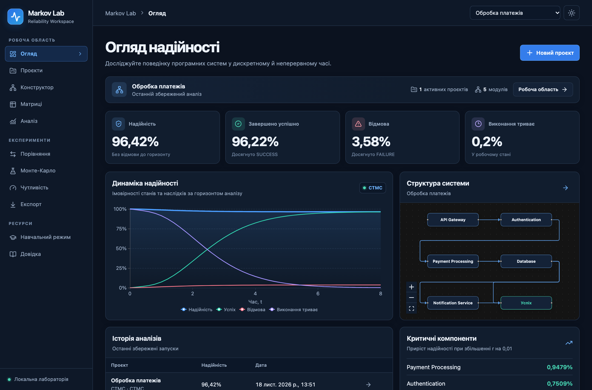
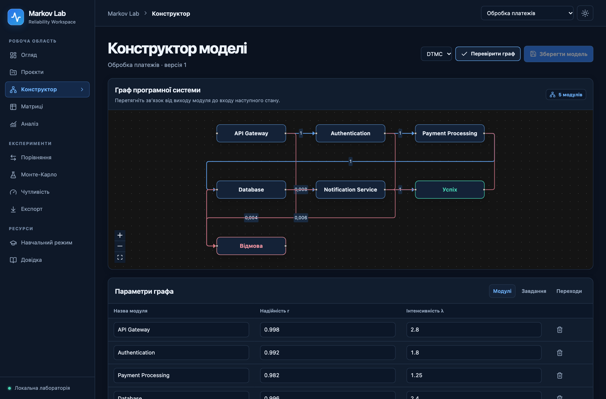
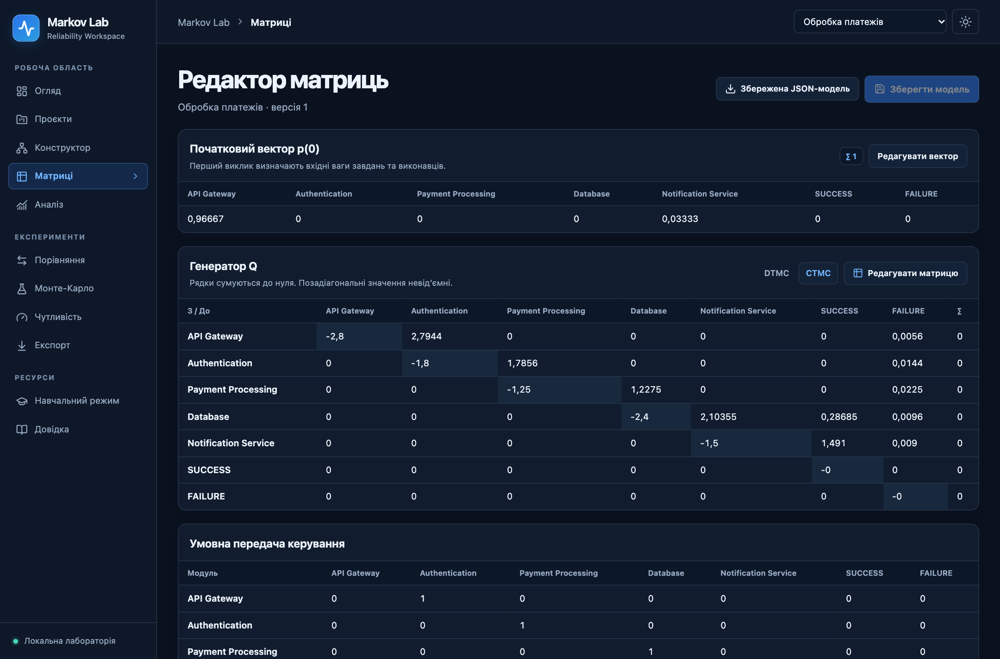
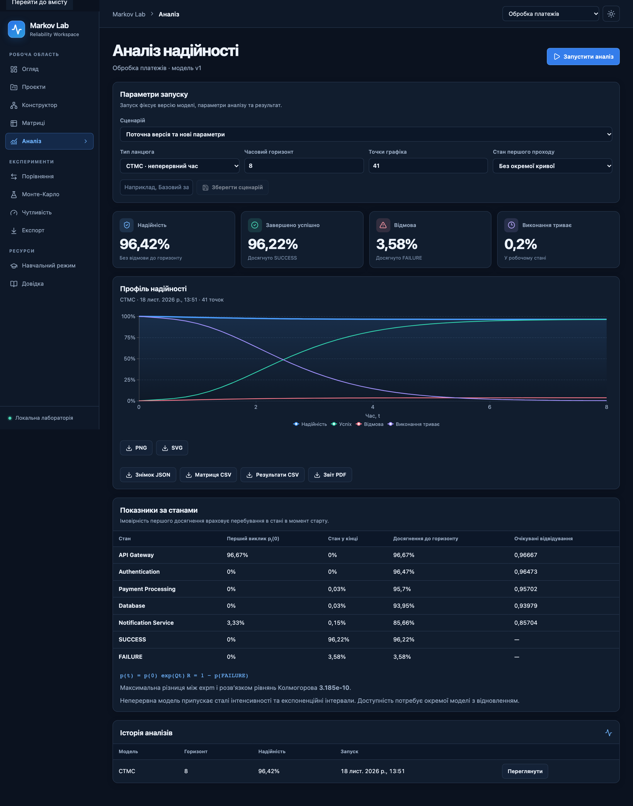

# Керівництво користувача

## Вступ, призначення та аудиторія

Markov Reliability Lab оцінює надійність одного запуску програмної системи за її структурою, профілем вхідних завдань і параметрами модулів. Керівництво призначене для студента, викладача та інженера, який моделює передачу керування й імовірність відмови.

## Швидкий старт і доступ

1. Запустіть Compose за [інструкцією](deployment.md) і відкрийте [localhost:3000](http://localhost:3000).
2. Лабораторія працює як локальний однокористувацький застосунок. Після відкриття з’являється «Огляд» із розрахунком демонстраційної системи.
3. Натисніть «Відкрити приклад». Застосунок створить проєкт із демомоделі й відкриє конструктор.
4. Перейдіть до «Аналізу» і натисніть «Запустити аналіз». Типово обрано CTMC з горизонтом 8.

## Огляд інтерфейсу

| Зона | Що в ній |
|---|---|
| 1. Ліве меню | Огляд, проєкти, конструктор, матриці, аналіз, експерименти та довідка |
| 2. Верхня панель | Активний проєкт і перемикач теми |
| 3. Рядок моделі й картки | Активна система, кількість моделей і модулів, чотири основні імовірності |
| 4. Графік і граф | Динаміка до горизонту й структура системи |
| 5. Нижні панелі | Останні запуски та чутливість модулів |

## Створення та редагування

1. У «Проєктах» натисніть «Новий проєкт», введіть назву та створіть його. Версія 1 містить готовий вхідний модуль із маршрутом у SUCCESS. Також доступний імпорт JSON або готові приклади.
2. У «Конструкторі» додайте модулі. Для кожного задайте r у межах [0, 1] і додатну λ в обернених одиницях часу. Використовуйте однакову одиницю часу для всіх модулів і горизонту.
3. На вкладці «Завдання» задайте вхідну вагу кожного завдання та виберіть його виконавців. Якщо виконавців кілька, їхні ваги визначають частки. Модуль може відповідати кільком завданням.
4. На вкладці «Переходи» додайте маршрут через форму або з’єднайте вузли на графі. Введіть умовні імовірності. У кожного робочого модуля сума маршрутів дорівнює одиниці. Переходи в FAILURE будуються з 1−r.
5. Виберіть DTMC чи CTMC біля кнопки «Перевірити граф». Перевірте попередження та натисніть «Зберегти модель».

## Матриці та аналіз

У «Матрицях» перегляньте p(0), P і Q. «Редагувати вектор» та «Редагувати матрицю» створюють ручні значення. Повернення до автоматичного режиму використовує профіль завдань і маршрути. Для P сума рядка дорівнює одиниці, для Q — нулю. Кінцеві стани мають поглинаючі рядки.

Виберіть дискретний чи неперервний час, горизонт, число точок і за потреби ціль першого проходу. Дайте сценарію назву й збережіть його, якщо плануєте повторювати запуск на тій самій версії. Натисніть «Запустити аналіз».

У показниках «Надійність» відповідає частці запусків без FAILURE до горизонту. «Завершено успішно» читається окремо. «Виконання триває» показує масу в робочих станах. У таблиці за станами перший виклик означає старт у конкретному модулі, а перше досягнення враховує всі входи до горизонту. У CTMC відображається максимальна різниця з розв’язком Колмогорова.

## Збереження та експорт

Збереження в редакторі додає версію. В «Аналізі» відкривайте історичні результати з таблиці запусків. У «Порівнянні» можна вибрати базовий і покращений збережені запуски. «Експорт» дозволяє завантажити модель версії в JSON, знімок запуску, матрицю CSV, серію CSV і PDF. PNG та SVG завантажуються з графіка відповідного запуску. Для імпорту використовуйте JSON моделі з «Експорту» або демонстраційний файл.

## FAQ і відновлення роботи

| Симптом | Рішення |
|---|---|
| Рядок C/P не дає 1 або рядок Q не дає 0 | Відкрийте «Переходи» чи «Матриці», знайдіть помилковий рядок і виправте числа. |
| Завдання без додатної ваги виконавця | На вкладці «Завдання» позначте виконавця й задайте вагу понад нуль. |
| Після змін аналіз поточної версії недоступний | Збережіть модель і повторіть запуск. Збережений сценарій використовує власну версію. |
| Успішне завершення нижче за надійність | Перевірте картку «Виконання триває». Її значення разом з успіхом дорівнює надійності. |

Перші два випадки перевіряються тестами валідатора та матриць. Два останні спираються на перевірені сценарії збереження й математичні еталони.
